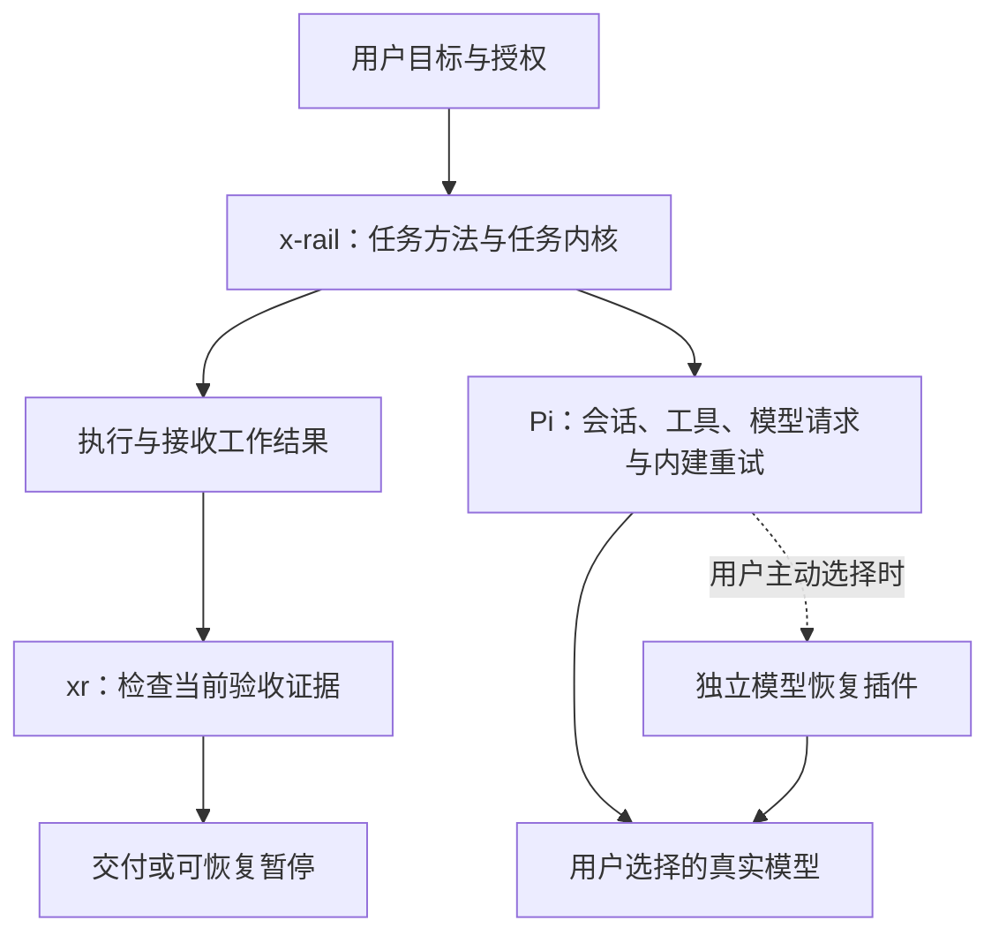

# 总体设计

日期：2026-10-22。状态：设计基准，待实施。

## 职责分离

类比前端：业务页面维护“订单是否交付”，请求层维护“这次请求是否成功”。请求成功不等于订单完成，请求失败也不应丢失订单现场。



模型插件与 x-rail 之间没有调用箭头。任务层通过 Pi 的结算事件知道请求最终成功、失败或被中止，既不需要知道重试几次，也不需要知道备用模型名单。

| 模块 | 拥有的责任 | 不拥有的责任 |
| --- | --- | --- |
| 任务方法：入口、流程卡 | 判断目标、选最短路径、拆可验收结果、取舍、按授权委派与审查 | 手填程序可派生的状态、猜测模型健康、计时重试 |
| 任务内核：`xr` | 工作项依赖与写入占用、证据绑定、当前有效性、暂停恢复、完成检查和收据 | 调用模型、选择模型、后台调度进程 |
| Pi 任务适配：独立任务守卫 | 固定会话与运行、记录工具现场、结算时消费检查结果、补任务胶囊 | 重试模型、探测服务、修改默认模型、按回答语气猜用户授权 |
| Pi 宿主 | 会话循环、模型请求、重试等待与取消、压缩、工具执行、原生子代理通知 | 业务是否已经交付 |
| 独立模型恢复插件 | 显式启用后的模型选择、少量网关暂时错误兼容、分支内冷却 | 读写任务目录、推进工作项、判完成、生成交接、重放工具 |

任务守卫属于 x-rail 必要运行能力；**可选的是模型恢复插件**。纯技能加命令仍能人工推进与恢复，但若缺任务守卫，不能宣称自动续跑和自动现场记录可用。

## 三条运行路径

### 普通任务

适用：结果可在当前会话直接核对，无长期依赖或恢复需要。

读取相关代码与说明 → 实施或分析 → 实际验证 → 交付。分析/设计不改实现；用户明确要求保存方案时只写指定方案目录。普通任务不建 RUN、contract、state，也不使用 `task.py` 强制记账。

修复流程的停止条件：原问题有可复现入口，确认根因，修复后在同入口验证；有廉价且可重复的失败测试时保留修复前后输出。难以自动复现的视觉或外部故障如实记录证据限制，不能编造失败。是否委派按授权、材料和共享写入判断，不一律新派执行者。

### 持久任务

适用：跨会话、分阶段交付、依赖汇总、复杂分工、外部等待，或用户明确要求持久证据。

目标和验收 → 工作项与依赖 → 选择当前可做事项 → 执行 → 接收并验证 → 重新计算可做事项。审查与最终集成是同一张工作项表中的明确事项，不维护第二个进度系统。

- 可做事项只从**当前有效**的前置证据推出，写入范围独占。
- 有结果立即接收与检查，不等所有执行者结束才收割；有依赖就串行接力。
- 子代理启动回执只证明启动；原执行者状态未知时占用不释放，不重派同一写入范围。
- 保留已有独立审查要求；未授权或不可用时明确阻塞，不能用自查替代。
- 所有需求、当前产物和最终集成通过权威检查后，生成完成收据；交付本地结果不自动授权发布。

### 模型故障

Pi 先按其配置尝试内建重试。用户选了独立插件的虚拟模型时，下一次请求可改投另一个允许的模型；没装插件时沿用 Pi 原生行为。

成功恢复后，任务层看到正常继续。宿主最终错误后，任务守卫记录原始错误、已有证据和未决动作，持久化暂停并停止；**不把 error 再转成一个任务续跑，从而绕过模型重试上限**。

用户中止立即取消自动推进。宿主或进程突然崩溃可能来不及写交接；下次通过既有事件、绑定和工作项重建不确定现场，不保证崩溃瞬间一定有新 handoff。

## 权威状态与最小接口

像 Vue/React 的状态派生：工作项和验收证据是源数据，可做列表、进度摘要、完成结论都只读计算。

- `RUN.md`：目标、边界、授权来源、阶段与本次任务配置。
- `units.tsv`：工作项与依赖；TSV（Tab-Separated Values，制表符分隔表格）只由命令写。
- `ledger.tsv`：验收证据的版本与报告索引。
- `acceptance.tsv`：用户验收要求到工作项的对应。
- `events.jsonl`：JSONL（JSON Lines，每行一条结构化记录）保存工具、执行者接收及任务转移事实；用于恢复，不另建任务状态机。
- `binding.json`：工作区、运行、会话和绑定代次。
- `finish.json`：本次当前证据检查通过后的收据，不能单独作为永久完成结论。
- `capsule.md` / `handoff.md`：由以上事实生成的简短恢复摘要，不成为第二份事实源。

扩展通过命令执行 `inspect/bind/pause/capsule/finish` 和事件写入接口；它不自行解析表格再算一遍完成。命令入口固定显式 `--repo`、`--run-id` 和会话身份。具体契约见 [任务闭环](03-x-rail任务闭环.md)。

## 目录与依赖方向

```text
skills/x-rail/
  SKILL.md、playbooks/、stages/       任务方法
  scripts/xr 及现有共享检查工具        任务状态与验收
  extensions/
    x-run-guard.ts                  任务守卫唯一加载入口
    guard-core.ts、run-files.ts       任务决策与命令客户端
    host-events.ts                  工具现场、异步回执与归属
    file-io.ts、constants.ts         仅任务所需的本地工具与限制
plugins/pi-model-recovery/
  package.json、index.ts             独立 Pi 包与注册入口
  policy.ts、policy.test.ts          错误兼容与每请求选模型
  README.md                         显式配置、宿主要求、能力限制
```

插件源码先在本仓库独立目录准备，能单独导出和验收；不为此次设计另建仓库。它不被默认任务安装清单引用，不导入 `skills/x-rail`；任务代码也不导入插件。使用宿主已有扩展接口，不自造插件框架。

旧 failover 文件本轮先退出加载和打包路径，保留源码以供追溯；后续删除须用户明确同意。新任务链不经过旧 task.py；旧任务工具保留读取与人工显式恢复能力。若当前内核依赖 `frontier.overlap` 等通用路径重叠函数，允许复用；它们不能反向要求创建旧 contract/state。

## 任务守卫的决定范围

任务守卫只返回“继续任务、等待已有执行者、暂停、任务检查已满足”四种结果，优先级如下：

1. 取消、会话变化或绑定代次失效：丢弃旧自动动作，保存可保存的现场。
2. 无任务绑定：不介入普通对话。
3. 宿主最终错误：暂停；不重试、不切模型。
4. 检查器失败、状态损坏或副作用不确定：暂停。
5. 真实权限边界或外部等待：记录并停止；可逆选择直接决策，不制造拍板问题。
6. 验收已满足：通过 `xr finish` 再检查并生成收据；随后允许交付。
7. 已有活跃执行者且暂无可做事项：让宿主通知接管等待，不注入“继续”刷轮次。
8. 有可做事项或可核实的进行项：在宿主结算边界发一次任务继续；相同语义进度连续三次未变则暂停诊断。每任务自动续跑最多 200 次，达到上限保存现场，不能清零换会话绕过。
9. 无可做事项但未完成：报告具体依赖/验收缺口并暂停，不能把“前沿为空”当完成。

取消代次是“旧异步工作是否还有效”的号牌；它只保护任务检查与后续动作，不负责模型重试。`asksUser` 的文本匹配退出机制停用，真实等待必须来自结构化权限门或外部等待记录。

## 安装、兼容与版本

x-rail 与模型插件各有独立打包清单和本地验证入口。准备脚本只从指定 Git 提交导出到用户指定的**全新目录**，拒绝覆盖，生成来源提交与文件摘要；不携带 node_modules、个人配置、运行数据、历史方案或未提交修改。

两种产物各自给出需要安装的文件、加载入口与兼容版本；不把二者捆绑。实际安装、激活、旧扩展退出、回滚指针切换放在另一个明确授权步骤。升级预检若发现旧 failover 仍活动，拒绝组合激活并列出冲突入口，不能偷偷删旧文件或双重注册。

开发分支、v3 工作区与当前宿主安装各自保留。旧运行不自动迁移；格式完整且显式接续的运行才可启用自动推进，旧格式给出只读摘要和人工恢复步骤。读取旧任务不重写其历史证据。

## 观测与验收边界

任务层记录：单元完成、接收、有效证据、自动继续、暂停原因、恢复及人工继续关联。插件记录：所选虚拟模型、实际模型、错误兼容、路由选择和宿主重试结果，沿用 Pi 会话记录。

不做跨层遥测总线。首字节与网络空闲时间只有宿主实际提供时才报告；缺失就写未知。自检分别读取已有记录，在相同用例比较人工继续次数、错误到恢复/暂停的耗时及实际交付，不把等待用户决定算模型故障，不把“自动暂停”算“恢复成功”。真实使用指标需要分母和观测窗，离线通过只证明对应场景。
